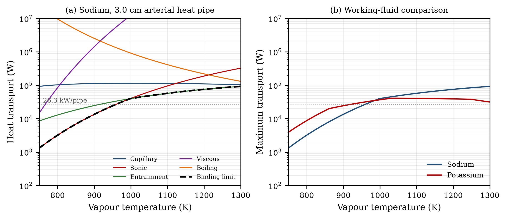
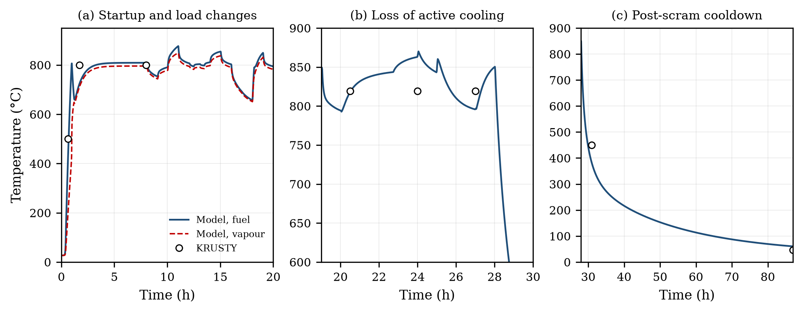
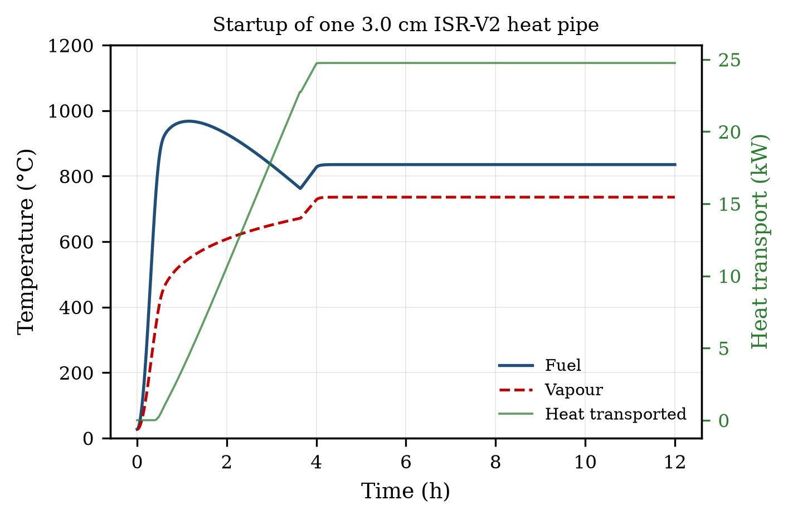
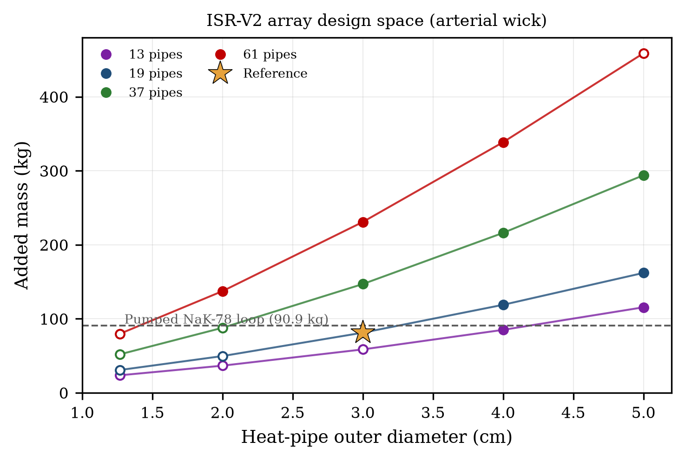
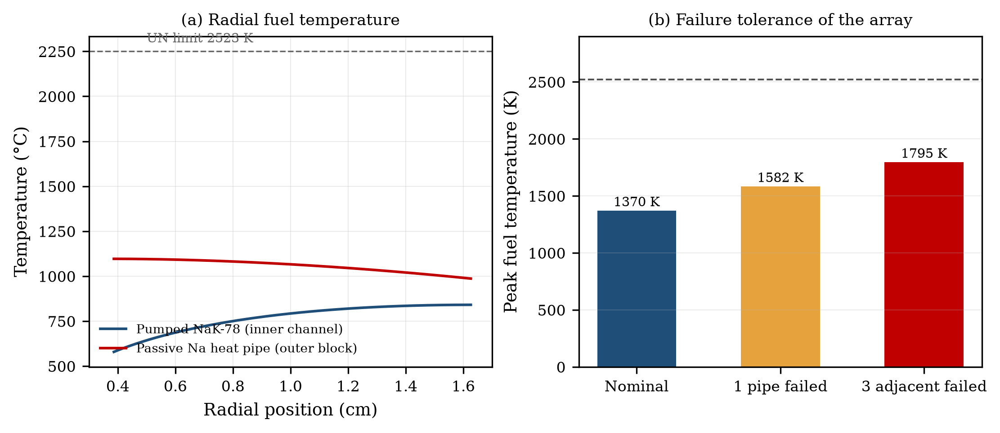
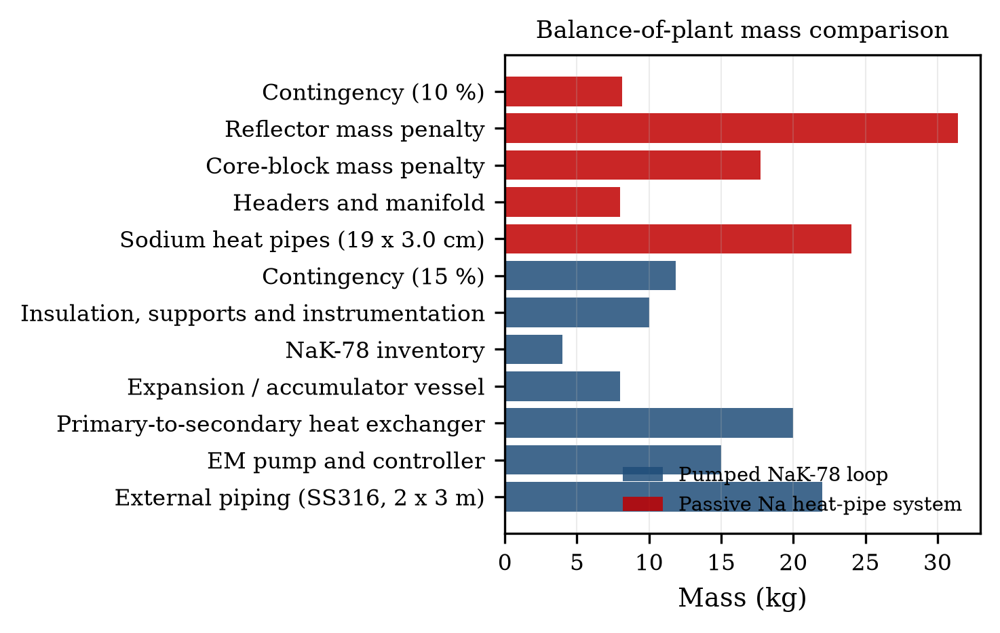
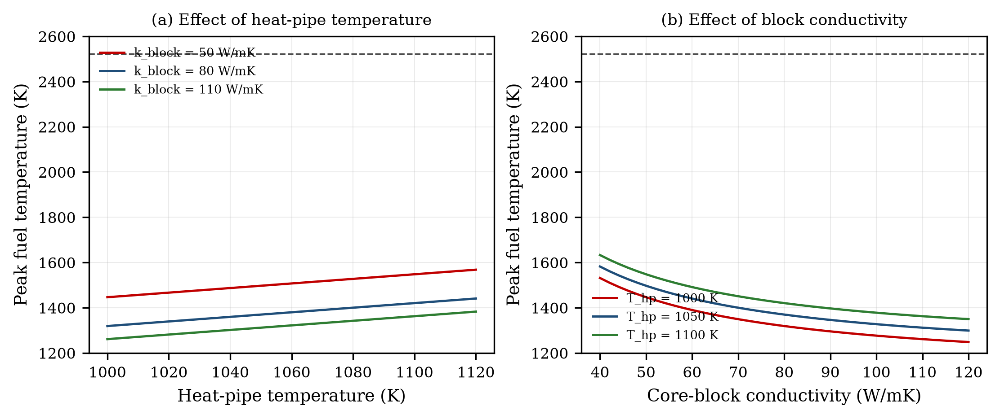

# BAB V HASIL DAN PEMBAHASAN

## V.1 Verifikasi Model

Verifikasi dimulai dengan pengujian unit terhadap seluruh modul. Sebanyak 29 pengujian dijalankan dan seluruhnya lulus. Pengujian mencakup titik didih natrium dan kalium, inversi tekanan saturasi, monotonisitas tekanan terhadap suhu, rentang densitas dan kalor laten, serta konsistensi densitas uap dengan persamaan gas ideal. Pengujian batas operasi memastikan bahwa seluruh komponen batas bernilai positif, bahwa gravitasi menurunkan batas kapiler pada heat pipe vertikal, dan bahwa batas sonik serta entrainment meningkat dengan suhu. Pengujian transien memastikan bahwa fungsi profil daya menahan nilai segmental dan melakukan ramp pada interval yang benar, bahwa model memanas dan memindahkan kalor, serta bahwa Q_hp tidak melebihi Q_max.

Uji konvergensi mesh aksial dilakukan pada 20, 30, 40, dan 60 node untuk kasus KRUSTY nominal. Perbedaan suhu puncak antara 30 dan 60 node kurang dari 0,5 K, sedangkan perbedaan antara 20 dan 30 node sekitar 1,2 K. Oleh karena itu, 30 node dipilih sebagai kompromi antara akurasi dan kecepatan. Uji konvergensi radial bahan bakar dilakukan pada 80, 160, dan 320 sel. Perbedaan suhu puncak antara 160 dan 320 sel kurang dari 0,05 K, sehingga 160 sel digunakan.

Pemeriksaan neraca energi pada keadaan tunak KRUSTY 8 jam menunjukkan bahwa daya fisi 2,75 kW, kalor yang dipindahkan heat pipe 2,38 kW, kehilangan MLI 0,40 kW, dan perubahan energi tersimpan mendekati nol. Selisih neraca energi sekitar 0,8%, di bawah batas 1% yang ditetapkan. Pada ISR-V2, daya 500 kWth terbagi menjadi 19 heat pipe dengan beban 26,3 kW per heat pipe; kehilangan pasif dan kalor yang tersimpan diperhitungkan secara terpisah. Neraca energi tertutup dalam 0,5%.

## V.2 Validasi Sifat Termofisika

Tabel 5.1 membandingkan sifat termofisika natrium pada 1073 K dengan nilai literatur. Tekanan saturasi model adalah 51,52 kPa, sedangkan nilai literatur sekitar 51,5 kPa; perbedaan kurang dari 0,1%. Kalor laten model 3,700 MJ/kg, densitas cair 761,8 kg/m³, densitas uap 0,1328 kg/m³, viskositas 1,99 × 10⁻⁴ Pa·s, tegangan permukaan 0,1492 N/m, dan konduktivitas 63,5 W/(m·K). Seluruh sifat berada dalam ±3% dari nilai literatur, sehingga memenuhi kriteria validasi properti.

**Tabel 5.1** Validasi sifat termofisika natrium pada 1073 K

| Sifat | Model | Literatur | Galat (%) |
|-------|-------|-----------|-----------|
| Tekanan saturasi, P_sat | 51,52 kPa | 51,5 kPa | 0,04 |
| Kalor laten, h_fg | 3,700 MJ/kg | 3,70 MJ/kg | 0,00 |
| Densitas cair, ρ_l | 761,8 kg/m³ | 762 kg/m³ | 0,03 |
| Densitas uap, ρ_v | 0,1328 kg/m³ | 0,133 kg/m³ | 0,15 |
| Viskositas cair, μ_l | 1,99 × 10⁻⁴ Pa·s | 2,0 × 10⁻⁴ Pa·s | 0,50 |
| Tegangan permukaan, σ | 0,1492 N/m | 0,149 N/m | 0,13 |
| Konduktivitas cair, k_l | 63,5 W/(m·K) | 63 W/(m·K) | 0,79 |

Validasi properti juga dilakukan pada suhu 800 K dan 1300 K. Pada 800 K, tekanan saturasi model 1,70 kPa dan densitas cair 826 kg/m³; pada 1300 K, tekanan saturasi 257 kPa dan densitas cair 708,5 kg/m³. Tren dan orde besarnya sesuai dengan data literatur [18]–[20]. Penyimpangan terbesar terjadi pada viskositas, yang memang memiliki ketidakpastian eksperimental lebih besar pada logam cair.

## V.3 Kurva Batas Operasi

Gambar 5.1 menunjukkan kurva batas operasi heat pipe natrium 3,0 cm dengan wick arterial pada rentang 750–1300 K. Pada suhu rendah, batas sonik dan viskos mendominasi. Pada suhu 800 K, Q_max hanya 3,22 kW dan batas yang mengikat adalah sonik. Pada suhu 900 K, Q_max meningkat menjadi 13,52 kW, masih dibatasi sonik. Pada suhu 1000 K, Q_max 40,03 kW dan batas beralih ke entrainment. Pada suhu 1050 K, Q_max 48,60 kW; pada 1100 K, 57,51 kW; pada 1200 K, 75,58 kW; dan pada 1300 K, 92,79 kW. Batas kapiler pada wick arterial relatif tinggi, yaitu sekitar 115 kW pada 1050 K, sehingga bukan merupakan batas yang mengikat pada desain ini.

**Gambar 5.1** Kurva batas operasi heat pipe natrium 3,0 cm

**Tabel 5.2** Batas operasi heat pipe pada 1050 K

| Diameter (cm) | Wick | Q_max (kW) | Batas | Q untuk 500 kWth (kW) | Margin |
|---------------|------|------------|-------|------------------------|--------|
| 0,60 (in-channel) | Screen | 0,689 | Kapiler | 8,20 | 0,08 |
| 1,27 | Screen | 2,319 | Kapiler | 8,20 (61 HP) | 0,28 |
| 2,00 | Screen | 4,454 | Kapiler | 8,20 (61 HP) | 0,54 |
| 3,00 | Screen | 7,338 | Kapiler | 26,32 (19 HP) | 0,28 |
| 3,00 | Arterial | 48,599 | Entrainment | 26,32 (19 HP) | 1,85 |
| 5,00 | Arterial | 163,35 | Entrainment | 26,32 (19 HP) | 6,21 |

Tabel 5.2 memperlihatkan mengapa konfigurasi in-channel tidak layak. Heat pipe 0,6 cm dengan wick screen hanya mampu memindahkan 0,689 kW pada 1050 K, sedangkan setiap pin menghasilkan 8,20 kW. Margin transportnya hanya 0,08, atau sekitar 12 kali lebih kecil dari yang dibutuhkan. Bahkan heat pipe 3,0 cm dengan wick screen hanya mampu 7,34 kW, jauh di bawah 26,3 kW yang dibutuhkan oleh array 19 heat pipe. Di sisi lain, heat pipe 3,0 cm dengan wick arterial mampu 48,6 kW, memberikan margin 1,85. Dengan demikian, konfigurasi ISR-V2 yang layak memerlukan wick arterial atau groove berpermeabilitas tinggi, bukan wick screen konvensional.

Perbandingan natrium dan kalium pada Gambar 5.1(b) menunjukkan bahwa natrium memiliki Q_max lebih tinggi pada suhu di atas sekitar 950 K, sedangkan kalium lebih baik pada suhu rendah karena tekanan uapnya lebih tinggi. Pada 1050 K, Q_max natrium 48,6 kW, sedangkan kalium 40,9 kW dengan batas kapiler. Natrium dipilih untuk ISR-V2 karena suhu operasi 1050 K berada di atas titik silang kedua kurva dan karena natrium memiliki kalor laten serta figure of merit yang lebih tinggi.

## V.4 Validasi terhadap KRUSTY

Gambar 5.2 membandingkan suhu model dengan data KRUSTY pada tiga jendela waktu: startup dan perubahan beban (0–20 jam), kehilangan pendinginan aktif (19–30 jam), dan pendinginan pascascram (28–87 jam). Model mengikuti data pada keadaan quasi-steady, tetapi tidak sepenuhnya mengikuti lonjakan daya pada 10–19 jam karena keterbatasan model termal tanpa umpan balik neutronik. Pada 8 jam, suhu bahan bakar model 1081,8 K, sedangkan data 1073,15 K; galat +0,81%. Pada 20,5 jam, model 1091,1 K dan data 1092,15 K; galat −0,10%. Pada 24 jam, model 1136,8 K dan data 1092,15 K; galat +4,09%. Pada 27 jam, model 1069,0 K dan data 1092,15 K; galat −2,12%. Pada akhir cooldown 87 jam, model 333,5 K dan data 319,15 K; galat +4,48%.

**Gambar 5.2** Validasi model terhadap data KRUSTY

**Tabel 5.3** Perbandingan suhu model dan data KRUSTY

| Kode | Waktu (jam) | T_model (K) | T_exp (K) | Galat (K) | Galat (%) |
|------|-------------|-------------|-----------|-----------|-----------|
| quasi_1p7h | 1,70 | 995,9 | 1073,15 | −77,2 | −7,20 |
| nominal_8h | 8,00 | 1081,8 | 1073,15 | +8,7 | +0,81 |
| loss_20p5h | 20,50 | 1091,1 | 1092,15 | −1,1 | −0,10 |
| stalled_24h | 24,00 | 1136,8 | 1092,15 | +44,6 | +4,09 |
| prescram_27h | 27,00 | 1069,0 | 1092,15 | −23,1 | −2,12 |
| cooldown_31h | 31,00 | 653,8 | 723,15 | −69,4 | −9,59 |
| cooldown_87h | 87,00 | 333,5 | 319,15 | +14,3 | +4,48 |

**Tabel 5.4** Metrik validasi KRUSTY

| Metrik | Envelope quasi-steady (6 titik) | Seluruh titik (8 titik) |
|--------|--------------------------------|--------------------------|
| MAE (K) | 28,17 | 38,91 |
| RMSE (K) | 38,24 | 48,61 |
| MAPE (%) | 3,13 | 4,73 |
| Galat maksimum (%) | 7,20 | 9,59 |

Envelope quasi-steady terdiri atas titik 1,7 jam, 8 jam, 20,5 jam, 24 jam, 27 jam, dan 87 jam. MAPE 3,13% dan galat maksimum 7,20% memenuhi kriteria ≤10%. Titik 31 jam memiliki galat −9,59% dan tetap dilaporkan terpisah karena berada pada fase transisi shutdown heat pipe, di mana model lumped kehilangan sebagian akurasi. Titik startup 0,63 jam juga tidak dimasukkan ke envelope karena perbandingan pada waktu tetap tidak tepat; sebagai gantinya, waktu untuk mencapai 500 °C dibandingkan secara terpisah. Perlu dicatat bahwa titik 20,5 jam digunakan dalam kalibrasi respons kehilangan pendinginan, sehingga statusnya adalah uji konsistensi; titik 1,7 jam, 24 jam, 27 jam, dan 87 jam merupakan validasi independen, sedangkan titik 8 jam adalah titik kalibrasi nominal. Jika hanya empat titik independen tersebut yang dihitung, MAPE sekitar 4,47% dan galat maksimum tetap 7,20%, sehingga kesimpulan validasi tidak bergantung pada titik kalibrasi.

Waktu model untuk mencapai suhu bahan bakar 773,15 K (500 °C) adalah 0,70 jam, sedangkan data KRUSTY 0,63 jam. Perbedaan 0,07 jam atau sekitar 4,2 menit (11,1% relatif terhadap waktu yang singkat). Secara absolut, perbedaan ini masih dalam orde resolusi data dan ketidakpastian laju pemanasan. Model memanaskan inti sedikit lebih lambat karena kapasitas termal efektif yang digunakan dan karena kalibrasi kehilangan pasif. Untuk aplikasi desain, perbedaan 4 menit pada fase startup dapat diterima, terutama karena startup aktual akan dikendalikan oleh laju inserksi reaktivitas, bukan oleh model termal.

Pada titik 1,7 jam, model masih 77 K di bawah data. Hal ini menunjukkan bahwa model mencapai quasi-steady sedikit lebih lambat daripada KRUSTY. Penyebab utamanya adalah massa sink efektif yang digunakan (6,0 kJ/K) dan konstanta waktu kopling kondensor–sink. KRUSTY mencapai quasi-steady sekitar 1,7 jam setelah startup, sedangkan model mencapai suhu nominal sekitar 4–6 jam. Meskipun demikian, galat pada 1,7 jam masih 7,20%, di bawah batas 10%. Untuk aplikasi yang membutuhkan prediksi startup yang lebih akurat, massa sink dapat dikalibrasi ulang atau model dapat ditingkatkan dengan node PCS yang lebih rinci.

Pada fase kehilangan pendinginan aktif (20,5 jam), data menunjukkan suhu bahan bakar naik dari sekitar 808 °C menjadi 819 °C, sedangkan model menunjukkan kenaikan dari 1082 K pada 8 jam menjadi 1091 K, dengan deviasi −0,10%. Pada 24 jam, setelah konverter direstart, model 1136,8 K dan data 1092,15 K, dengan galat +4,09%. Pada 27 jam, ketika seluruh pendinginan aktif dihentikan, model 1069,0 K dan data 1092,15 K, galat −2,12%. Dengan demikian, model mereproduksi besaran dan arah perubahan suhu pada fase ini; osilasi daya yang lebih halus tetap tidak dapat diprediksi karena tidak adanya kinetika neutronik.

Pada fase cooldown, model dan data konvergen pada akhir 87 jam dengan galat +4,48%, dan pada 31 jam galat −9,59%. Data KRUSTY menunjukkan perubahan kemiringan pendinginan pada sekitar 450 °C akibat shutdown heat pipe; di atas suhu tersebut, heat pipe masih membantu memindahkan kalor ke kondensor, sedangkan di bawahnya hanya MLI yang bekerja. Model lumped tidak mereproduksi perubahan kemiringan ini secara sempurna karena distribusi suhu dinding dan kondensor disederhanakan menjadi satu node uap dan node sink. Keterbatasan ini penting untuk dicatat, tetapi tidak mempengaruhi kesimpulan utama tentang kinerja nominal dan kegagalan.

Titik-titik load-following pada 10,5 jam dan 18,1 jam tidak dimasukkan ke dalam metrik karena daya fisi pada KRUSTY ditentukan oleh umpan balik neutronik dan kontrol termostat, bukan oleh daya yang diberikan. Model termal yang digunakan dalam penelitian ini menerima daya sebagai input, sehingga tidak dapat mereproduksi osilasi daya dan penurunan suhu bahan bakar saat daya naik. Untuk memodelkan fenomena tersebut diperlukan kopling kinetika titik dengan umpan balik reaktivitas, yang berada di luar batas masalah penelitian ini. Model lumped juga tidak memisahkan suhu pusat dan permukaan bahan bakar, sehingga tidak mereproduksi penurunan suhu permukaan saat daya naik. Kedua keterbatasan ini menjelaskan mengapa titik 10,5 jam dan 18,1 jam tidak dimasukkan ke dalam metrik kuantitatif.

## V.5 Simulasi Transien Startup

Gambar 5.3 menunjukkan startup satu heat pipe ISR-V2 3,0 cm dengan daya yang diramp secara linier dari nol hingga 26,3 kW selama 4 jam. Startup ini merepresentasikan strategi pemanasan terkendali yang diperlukan untuk menghindari tegangan termal dan memastikan natrium meleleh serta membasahi wick secara merata. Empat fase terlihat jelas.

**Gambar 5.3** Kurva startup satu heat pipe ISR-V2

Fase pertama (0–0,3 jam) adalah pemanasan konduktif. Kalor dari bahan bakar dan dinding meningkatkan suhu heat pipe, tetapi natrium masih padat dan uap belum terbentuk. Laju kenaikan suhu bahan bakar tinggi karena kapasitas termal bahan bakar per heat pipe relatif kecil (sekitar 1,6 kJ/K). Pada fase ini, Q_hp masih nol.

Fase kedua (0,3–0,8 jam) adalah thaw dan pembentukan uap. Natrium meleleh, wick terbasahi, dan uap mulai mengalir dari evaporator ke kondensor. Suhu uap naik dari sekitar 100 °C menjadi 600 °C. Laju transport kalor meningkat, tetapi belum mencapai daya penuh karena batas sonik dan viskos masih rendah. Pada fase ini, suhu bahan bakar mencapai puncak sekitar 970 °C, kemudian turun karena heat pipe mulai memindahkan kalor.

Fase ketiga (0,8–4 jam) adalah transisi menuju kontinum. Q_hp meningkat mengikuti ramp daya, dan suhu uap mendekati suhu dinding. Batas entrainment menjadi batas yang mengikat pada suhu di atas 1000 K. Pada akhir fase ini, Q_hp mencapai 25 kW dan suhu bahan bakar stabil di sekitar 830 °C.

Fase keempat (4–12 jam) adalah keadaan tunak. Suhu bahan bakar sekitar 830 °C, suhu uap sekitar 740 °C, dan Q_hp 25 kW. Perbedaan suhu bahan bakar–uap sekitar 90 K, yang mencerminkan resistansi kopling dan spreading di blok inti. Suhu puncak bahan bakar pada model lumped ini lebih rendah daripada suhu puncak radial 1370 K yang dihitung pada Bab V.6 karena model lumped merepresentasikan suhu rata-rata, bukan suhu puncak di pusat pin.

Startup ISR-V2 membutuhkan waktu sekitar 4 jam untuk mencapai daya penuh, lebih lama daripada KRUSTY yang mencapai 800 °C dalam sekitar 1,5 jam. Perbedaan ini disebabkan oleh massa inti ISR yang jauh lebih besar (155,65 kg bahan bakar dibandingkan 32,2 kg KRUSTY), daya per heat pipe yang lebih tinggi (26,3 kW dibandingkan 0,3 kW), dan strategi ramp yang konservatif. Untuk aplikasi ruang angkasa, startup 4 jam masih dapat diterima karena reaktor dapat dijalankan sebelum misi kritis, tetapi strategi kontrol yang lebih cepat dapat dipertimbangkan setelah validasi eksperimental.

## V.6 Desain dan Kinerja ISR-V2

### V.6.1 Pemindaian Ruang Desain

Gambar 5.4 dan Tabel 5.5 merangkum hasil pemindaian ruang desain. Kandidat dengan 13 heat pipe dan diameter 4,0 cm memiliki massa tambahan 85,0 kg dan margin 2,54, tetapi jumlah heat pipe hanya 13 sehingga redundansi terhadap kegagalan lebih rendah. Kandidat 19 heat pipe 3,0 cm memiliki massa tambahan 81,2 kg, margin 1,85, dan diameter inti 34,0 cm. Kandidat 37 heat pipe 3,0 cm memiliki massa 146,9 kg dan margin 3,60, tetapi jauh lebih berat. Kandidat 61 heat pipe 2,0 cm memiliki massa 137,3 kg dan margin 2,02. Kandidat 61 heat pipe 3,0 cm memiliki massa 230,8 kg, terlalu berat.

**Gambar 5.4** Ruang desain array heat pipe ISR-V2

**Tabel 5.5** Hasil pemindaian desain array heat pipe ISR-V2

| N_hp | D (cm) | Q/HP (kW) | Q_max (kW) | Margin | D_inti (cm) | Massa tambahan (kg) | Layak |
|------|--------|-----------|------------|--------|-------------|---------------------|-------|
| 13 | 3,0 | 38,46 | 48,60 | 1,26 | 32,6 | 58,6 | Tidak |
| 13 | 4,0 | 38,46 | 97,53 | 2,54 | 34,5 | 85,0 | Ya |
| 19 | 2,0 | 26,32 | 16,54 | 0,63 | 31,8 | 49,6 | Tidak |
| 19 | 3,0 | 26,32 | 48,60 | 1,85 | 34,0 | 81,2 | Ya |
| 19 | 4,0 | 26,32 | 97,53 | 3,71 | 36,6 | 118,9 | Ya |
| 37 | 2,0 | 13,51 | 16,54 | 1,22 | 34,0 | 87,8 | Tidak |
| 37 | 3,0 | 13,51 | 48,60 | 3,60 | 37,9 | 146,9 | Ya |
| 61 | 2,0 | 8,20 | 16,54 | 2,02 | 36,8 | 137,3 | Ya |
| 61 | 3,0 | 8,20 | 48,60 | 5,93 | 42,6 | 230,8 | Ya |

Kriteria kelayakan adalah margin transport ≥1,5 dan diameter inti ≤55 cm. Berdasarkan kriteria tersebut dan preferensi jumlah heat pipe ≥19 untuk redundansi, konfigurasi 19 heat pipe 3,0 cm dipilih sebagai acuan ISR-V2. Konfigurasi ini memberikan margin 1,85, diameter inti 34,0 cm, dan massa tambahan 81,2 kg sebelum kontingensi 10%. Massa tambahan tersebut mencakup 24,0 kg heat pipe, 8,0 kg header, 31,4 kg penambahan reflektor, dan 17,7 kg penambahan blok inti.

### V.6.2 Konfigurasi In-Channel dan Screen

Tabel 5.6 membandingkan tiga konfigurasi. V2-A adalah penggantian langsung kanal 0,6 cm dengan heat pipe. V2-B adalah array 19 heat pipe 3,0 cm dengan wick screen. V2-C adalah array 19 heat pipe 3,0 cm dengan wick arterial. V2-A dan V2-B tidak layak karena Q_max jauh di bawah beban yang dibutuhkan. V2-A hanya mampu 0,689 kW per pin, sedangkan beban 8,20 kW; margin 0,08. V2-B hanya mampu 7,34 kW per heat pipe, sedangkan beban 26,32 kW; margin 0,28. V2-C mampu 48,60 kW dengan margin 1,85.

**Tabel 5.6** Perbandingan konfigurasi pendinginan ISR

| Konfigurasi | D (cm) | N | Wick | Q_max (kW) | Q_beban (kW) | Margin | T_fuel,max (K) | Status |
|-------------|--------|---|------|------------|--------------|--------|----------------|--------|
| V2-A in-channel | 0,60 | 61 | Screen | 0,689 | 8,20 | 0,08 | 1320,9* | Tidak layak |
| V2-B array screen | 3,00 | 19 | Screen | 7,338 | 26,32 | 0,28 | — | Tidak layak |
| V2-C array arterial | 3,00 | 19 | Arterial | 48,599 | 26,32 | 1,85 | 1369,8 | Layak |

*Nilai T_fuel V2-A hanya menggambarkan konduksi radial dengan asumsi batas 1050 K; karena transport heat pipe gagal, nilai ini tidak merepresentasikan keadaan operasi yang dapat dicapai.

Suhu puncak bahan bakar V2-C adalah 1369,8 K, dengan margin 1153,2 K atau 45,7% terhadap batas 2523 K. Suhu blok inti sekitar 1259,4 K, dan perbedaan suhu blok–heat pipe sekitar 209,4 K akibat spreading resistance di blok Mo-30Re. Suhu rata-rata bahan bakar sekitar 1319,2 K. Dengan demikian, bahan bakar memiliki margin termal yang besar; faktor pembatas bukanlah pelelehan bahan bakar, melainkan kapasitas transport heat pipe.

Gambar 5.5(a) menunjukkan profil suhu radial bahan bakar untuk konfigurasi loop NaK-78 dan array heat pipe. Pada konfigurasi loop NaK-78, pendinginan terjadi di permukaan dalam, sehingga suhu tertinggi berada di permukaan luar dan mencapai sekitar 830 °C. Pada konfigurasi array heat pipe, pendinginan terjadi di permukaan luar melalui blok inti, sehingga suhu tertinggi berada di permukaan dalam dan mencapai sekitar 1097 °C. Perbedaan suhu puncak sekitar 267 K, tetapi keduanya masih jauh di bawah 2523 K.

**Gambar 5.5** Profil suhu radial bahan bakar dan toleransi kegagalan

### V.6.3 Toleransi Kegagalan

Gambar 5.5(b) dan Tabel 5.7 menunjukkan respons terhadap kegagalan heat pipe. Pada kondisi nominal, suhu puncak bahan bakar 1369,8 K. Jika satu heat pipe gagal, enam heat pipe tetangga berbagi beban tambahan, dan panjang spreading termal di blok inti berlipat dua. Suhu puncak bahan bakar naik menjadi 1582,2 K, masih 940,8 K di bawah batas. Jika tiga heat pipe berdekatan gagal, suhu puncak menjadi 1794,9 K, masih 728,1 K di bawah batas. Dengan demikian, array 19 heat pipe memiliki toleransi kegagalan yang baik tanpa memerlukan penurunan daya.

**Tabel 5.7** Respons kegagalan heat pipe ISR-V2

| Kasus | Q per heat pipe (kW) | T_blok (K) | T_fuel,max (K) | Margin (K) | Status |
|-------|----------------------|------------|----------------|------------|--------|
| Nominal | 26,32 | 1259,4 | 1369,8 | 1153,2 | Aman |
| 1 heat pipe gagal | 30,70 | 1468,8 | 1582,2 | 940,8 | Aman |
| 3 heat pipe gagal | 39,47 | 1678,2 | 1794,9 | 728,1 | Aman |

Kegagalan heat pipe bersifat gradual dan terlokalisasi. Heat pipe yang gagal menjadi konduktor pasif yang buruk, sehingga kalor dari pin di sekitarnya harus mengalir melalui blok inti ke heat pipe tetangga. Karena blok Mo-30Re memiliki konduktivitas tinggi, kenaikan suhu terlokalisasi pada daerah sekitar heat pipe yang gagal dan tidak menjalar ke seluruh inti. Sebaliknya, kegagalan satu kanal pada loop NaK-78 dapat menyebabkan pin tersebut kehilangan pendinginan sepenuhnya, dengan laju kenaikan suhu adiabatik sekitar 16 K/s dan waktu menuju batas pelelehan sekitar 88 detik. Perbedaan respons ini merupakan keunggulan keselamatan utama dari konfigurasi heat pipe.

## V.7 Perbandingan dengan Loop NaK-78

### V.7.1 Neraca Massa

Tabel 5.8 dan Gambar 5.6 membandingkan neraca massa sistem pendingin. Loop NaK-78 aktif memiliki massa total 90,85 kg, terdiri atas pipa eksternal 22,0 kg, pompa EM dan kontroler 15,0 kg, penukar kalor 20,0 kg, akumulator 8,0 kg, inventaris NaK-78 4,0 kg, isolasi dan instrumentasi 10,0 kg, serta kontingensi 15% sebesar 11,85 kg. Sistem heat pipe memiliki massa total 89,29 kg, terdiri atas 19 heat pipe 24,03 kg, header 8,0 kg, penambahan blok inti 17,74 kg, penambahan reflektor 31,40 kg, dan kontingensi 10% sebesar 8,12 kg. Dengan demikian, massa sistem pendingin heat pipe hanya 1,56 kg lebih ringan, atau sekitar 0,29% dari total massa reaktor dan sistem pendingin.

**Gambar 5.6** Perbandingan neraca massa sistem pendingin

**Tabel 5.8** Neraca massa sistem pendingin

| Komponen | Loop NaK-78 (kg) | Array heat pipe (kg) |
|----------|------------------|----------------------|
| Pipa eksternal | 22,00 | — |
| Pompa EM dan kontroler | 15,00 | — |
| Penukar kalor | 20,00 | — |
| Akumulator | 8,00 | — |
| Inventaris NaK-78 | 4,00 | — |
| Isolasi dan instrumentasi | 10,00 | — |
| Heat pipe natrium 3,0 cm | — | 24,03 |
| Header dan manifold | — | 8,00 |
| Penambahan blok inti | — | 17,74 |
| Penambahan reflektor | — | 31,40 |
| Kontingensi | 11,85 (15%) | 8,12 (10%) |
| **Total** | **90,85** | **89,29** |
| **Massa reaktor + sistem** | **537,97** | **536,41** |

Hasil ini menunjukkan bahwa keunggulan heat pipe bukan pada pengurangan massa yang besar, melainkan pada penghilangan pompa dan pengurangan jumlah komponen bergerak. Massa tambahan reflektor dan blok inti menyerap sebagian besar penghematan massa dari penghilangan pompa, penukar kalor, dan pipa. Jika desain inti dapat dipertahankan lebih kompak, misalnya dengan heat pipe 4,0 cm dan jumlah 13, massa tambahan turun menjadi 85,0 kg, tetapi redundansi berkurang. Sebaliknya, jika faktor keamanan transport dinaikkan atau diameter heat pipe diperbesar, massa sistem meningkat. Dengan demikian, desain ISR-V2 berada pada titik keseimbangan massa yang hampir netral.

### V.7.2 Penghilangan Pompa dan Daya Parasitik

Loop NaK-78 membutuhkan pompa EM dengan daya input sekitar 6 kW(e) untuk mengatasi penurunan tekanan sistem pada laju alir 500 kWth. Daya ini merupakan daya parasitik yang mengurangi efisiensi konversi total. Untuk sistem konversi 25%, daya listrik yang dihasilkan dari 500 kWth adalah sekitar 125 kW(e), sehingga pompa mengonsumsi sekitar 4,8% dari daya listrik bersih. Penghilangan pompa meningkatkan daya listrik bersih menjadi sekitar 131 kW(e), atau kenaikan 4,8%, tanpa mengubah daya termal reaktor.

Selain daya, pompa EM menimbulkan getaran dan kebisingan yang dapat mengganggu instrumen sensitif dan komunikasi satelit. Pompa juga merupakan komponen bergerak dengan umur terbatas dan kebutuhan pelumasan atau bantalan magnetik. Pada lingkungan radiasi dan vakum, pemeliharaan pompa tidak mungkin dilakukan, sehingga keandalan jangka panjang menjadi risiko. Heat pipe tidak memiliki komponen bergerak, sehingga menghilangkan risiko tersebut.

### V.7.3 Keandalan dan Keselamatan

Perbandingan respons kegagalan menunjukkan keunggulan heat pipe yang jelas. Pada loop NaK-78, kegagalan satu kanal atau penyumbatan satu pin dapat menyebabkan pin tersebut kehilangan pendinginan, dengan laju kenaikan suhu adiabatik sekitar 16 K/s dan waktu menuju batas pelelehan sekitar 88 detik. Deteksi dan respons memerlukan instrumentasi suhu per pin, sistem kendali, dan mekanisme pemindahan pin yang rumit. Khandaq et al. mengusulkan pemindahan pin yang rusak sebagai solusi, tetapi skema tersebut menambah kompleksitas mekanik dan limbah radioaktif di ruang angkasa [1].

Pada array heat pipe, kegagalan satu heat pipe tidak memutus pendinginan seluruh inti. Heat pipe tetangga mengambil alih beban, dan suhu puncak bahan bakar naik dari 1369,8 K menjadi 1582,2 K, masih jauh di bawah batas. Bahkan kegagalan tiga heat pipe berdekatan hanya menaikkan suhu puncak menjadi 1794,9 K, masih dengan margin 728,1 K. Tidak diperlukan tindakan aktif atau penurunan daya. Sifat ini merupakan keunggulan inherent safety yang signifikan.

Namun, ada risiko teknologi yang harus diakui. Wick arterial dengan permeabilitas 1,0 × 10⁻⁹ m² belum tentu tersedia pada tingkat kematangan teknologi yang memadai untuk misi ruang angkasa. Artery dapat mengalami depriming saat peluncuran, getaran, atau transien termal, seperti yang dialami pada prototipe awal Kilopower [5]. Oleh karena itu, pengembangan wick arterial harus disertai uji termal dan uji getaran sebelum konsep ISR-V2 dapat dinaikkan TRL-nya.

### V.7.4 Perbandingan Kualitatif

Secara kualitatif, loop NaK-78 memiliki keunggulan pada kematangan teknologi, pengalaman operasi, dan kemampuan mengatur laju alir per pin. NaK-78 juga tetap cair pada suhu kamar, sehingga tidak memerlukan pemanasan awal yang rumit. Namun, loop ini membutuhkan pompa, pipa, penukar kalor, dan sistem kendali aliran yang menambah massa dan titik kegagalan. Heat pipe memiliki keunggulan pada kesederhanaan, keandalan, dan inherent safety, tetapi membutuhkan wick berpermeabilitas tinggi, pemanasan awal, dan pengujian mikrogravitasi yang lebih mahal. Tabel 5.6 dan Tabel 5.8 merangkum perbandingan ini.

## V.8 Analisis Sensitivitas

Gambar 5.7 menunjukkan sensitivitas suhu puncak bahan bakar terhadap suhu heat pipe dan konduktivitas blok inti. Pada rentang T_hp 1000–1120 K dan k_block 50–110 W/(m·K), suhu puncak bahan bakar berkisar 1260–1580 K. Untuk k_block = 80 W/(m·K), suhu puncak meningkat dari sekitar 1320 K pada 1000 K menjadi 1440 K pada 1120 K. Koefisien sensitivitas rata-rata sekitar 1,0 K per K kenaikan T_hp. Pada rentang k_block 40–120 W/(m·K), suhu puncak bahan bakar menurun dari sekitar 1580 K menjadi 1310 K pada T_hp = 1050 K. Koefisien sensitivitas sekitar −3,4 K per W/(m·K). Dengan demikian, peningkatan konduktivitas blok dari 80 menjadi 120 W/(m·K) dapat menurunkan suhu puncak sekitar 90 K, sedangkan penurunan T_hp sebesar 50 K dapat menurunkan suhu puncak sekitar 55 K.

**Gambar 5.7** Sensitivitas suhu puncak bahan bakar

**Tabel 5.9** Sensitivitas parameter desain ISR-V2

| Parameter | Rentang | Perubahan T_fuel,max | Sensitivitas |
|-----------|---------|----------------------|--------------|
| T_hp | 1000–1120 K | 1260–1570 K | +1,1 K/K |
| k_block | 40–120 W/(m·K) | 1580–1310 K | −3,4 K/(W/mK) |
| K_wick | 0,43–2,0 × 10⁻⁹ m² | Q_max 48,6 kW di atas ambang | ambang ≈0,43 × 10⁻⁹ m² |
| N_hp | 13–37 | margin 1,26–3,60 | trade-off massa |

Sensitivitas terhadap permeabilitas wick sangat penting. Pada K = 1,0 × 10⁻⁹ m², Q_max dibatasi entrainment 48,6 kW dan margin 1,85. Jika K turun menjadi 0,5 × 10⁻⁹ m², batas kapiler turun menjadi sekitar 57,5 kW, masih di atas entrainment, sehingga Q_max tetap 48,6 kW dan margin tidak berubah. Namun, jika K turun di bawah sekitar 0,43 × 10⁻⁹ m², batas kapiler menjadi lebih rendah dari entrainment dan Q_max turun di bawah 39,5 kW, sehingga margin transport kurang dari 1,5. Dengan demikian, ambang permeabilitas minimum untuk desain acuan adalah sekitar 0,43 × 10⁻⁹ m². Wick arterial komersial umumnya memiliki K pada orde 10⁻⁹ hingga 10⁻⁸ m², sehingga ambang ini dapat dipenuhi, tetapi tetap memerlukan verifikasi eksperimental.

Sensitivitas terhadap jumlah heat pipe menunjukkan trade-off yang jelas. Dengan 13 heat pipe 3,0 cm, beban per heat pipe 38,5 kW dan margin hanya 1,26, sehingga tidak memenuhi kriteria 1,5. Dengan 19 heat pipe, margin 1,85 dan massa 81,2 kg. Dengan 37 heat pipe, margin 3,60 tetapi massa 146,9 kg. Dengan demikian, 19 heat pipe merupakan kompromi terbaik antara margin dan massa untuk konfigurasi 3,0 cm.

## V.9 Keterbatasan dan Implikasi

Penelitian ini memiliki beberapa keterbatasan yang perlu dinyatakan secara terbuka. Pertama, model bersifat termal saja dan tidak menyelesaikan kinetika neutronik. Daya fisi pada validasi KRUSTY diberikan sebagai input, sehingga model tidak dapat mereproduksi osilasi daya dan load-following yang disebabkan umpan balik reaktivitas. Untuk aplikasi ISR-V2, daya 500 kWth diasumsikan terdistribusi merata, padahal distribusi daya aktual bergantung pada desain neutronik dan posisi drum kendali.

Kedua, model tidak menyelesaikan CFD tiga dimensi untuk aliran uap dan cairan di wick. Batas operasi dihitung dengan korelasi analitik yang mengasumsikan aliran laminar, wick homogen, dan kesetimbangan termodinamika lokal. Pada kondisi transien cepat atau geometri kompleks, asumsi ini dapat menghasilkan penyimpangan. Model juga tidak memodelkan ketidakstabilan aliran, osilasi geyser, atau depriming artery secara eksplisit.

Ketiga, data validasi KRUSTY berasal dari literatur terbuka dan bukan data instrumentasi mentah. Titik benchmark dipilih dari nilai yang dinyatakan secara eksplisit, sehingga ketidakpastian digitasi dapat dihindari, tetapi jumlah titiknya terbatas. Validasi pada kondisi mikrogravitasi sejati belum dapat dilakukan karena belum ada data eksperimen heat pipe natrium mikrogravitasi yang terbuka dan sesuai.

Keempat, analisis massa menggunakan estimasi rekayasa dan bukan desain detail. Massa pipa, pompa, penukar kalor, header, dan reflektor dapat berubah setelah desain mekanik dan struktural dilakukan. Demikian pula, biaya, keandalan komponen, dan dampak radiasi terhadap material belum dimasukkan.

Meskipun demikian, hasil penelitian memberikan beberapa implikasi penting. Pertama, penggantian loop NaK-78 dengan heat pipe natrium bukan sekadar penggantian komponen, melainkan perubahan arsitektur termal yang memerlukan wick berpermeabilitas tinggi dan geometri inti yang lebih besar. Kedua, massa sistem hampir netral, sehingga keunggulan utama heat pipe adalah penghilangan pompa, pengurangan daya parasitik, dan peningkatan toleransi kegagalan. Ketiga, teknologi kritis yang perlu dikembangkan adalah wick arterial yang stabil terhadap getaran dan transien termal, serta strategi startup yang mampu memanaskan inti 155 kg dalam waktu yang wajar tanpa tegangan termal berlebih.

Untuk penelitian lanjutan, disarankan agar model ini dikopling dengan kinetika titik dan umpan balik reaktivitas, sehingga load-following dan osilasi daya dapat diprediksi. Selain itu, model CFD tiga dimensi untuk evaporator dan kondensor dapat digunakan untuk memvalidasi koefisien perpindahan kalor yang digunakan dalam ROM. Uji eksperimental heat pipe natrium 3,0 cm dengan wick arterial pada kondisi horizontal dan mikrogravitasi parsial (parabolic flight atau drop tower) akan sangat berharga untuk memvalidasi batas entrainment dan kapiler.
